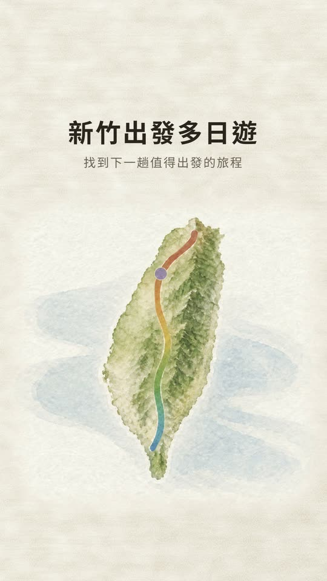

# 新竹出發多日遊

**從新竹出發，過一夜以上的自駕行程**　住哪裡、去哪裡，放在一起看

👉 **https://tw101099.github.io/hsinchu-multiday-trips/**

點上圖看 24 秒介紹影片。

## 怎麼用

1. 從「推薦行程」開始：先選方向（例如「桃竹苗後山」），再選路線（例如「雪霸觀霧／大鹿林道」），最後選一種玩法。也可以照天數、車程、體力、風格來篩。
2. 選好一趟，地圖會畫出從新竹出發、再開回新竹的整條路線，旁邊是每天的停點和每一段車程。
3. 點「當晚住 ○○」，這一晚的過夜基地、附近的住宿和景點會一起展開。
4. 出發那天按「當日導航」開 Google 地圖。按「分享這趟行程」，可以把連結傳給一起去的人。

不想照推薦走，也可以直接挑一個基地住下，再看附近有什麼；景點可以搜尋，或照主題、費力、季節篩。

## 這個站有什麼

- 157 條推薦行程、63 條路線，依方向分成桃竹苗後山、宜蘭北海岸東北角、中台灣山林湖泊、南台灣山海原鄉、花東縱谷海岸、跨區環線與離島。
- 107 個過夜基地。景點和住宿都掛在基地底下，清單上的車程是從基地出發、用實際道路算的。
- 1107 個景點與住宿，其中住宿 211 家（民宿、飯店、露營區）。
- 推薦行程的每一段車程也是實際算的，頭尾自動接回新竹；停留時間是估的。

## 加到手機主畫面

- iPhone／iPad（Safari）：按「分享」→「加入主畫面」。
- Android（Chrome）：選單 →「安裝應用程式」或「加到主畫面」。

加到主畫面之後，打開就像一個 App。沒有網路的時候，看過的頁面還打得開，但地圖底圖要有網路才會出來。

## 出發前

山區路況、林道封閉、園區開放時間和店家公休都會變動，出發前請以官方公告和店家粉專為準。這個網站只供排行程參考，不保證資訊正確或即時。

地圖底圖與圖磚來自 OpenStreetMap 貢獻者。

## 隱私

不用註冊、不用登入，沒有廣告。你的篩選和瀏覽狀態只存在你自己的裝置上，不會上傳。
網站使用不依賴 Cookie 的流量統計服務，以了解整體造訪情況，不追蹤個人的使用紀錄。

## 授權

MIT License，見 [LICENSE](LICENSE)。
